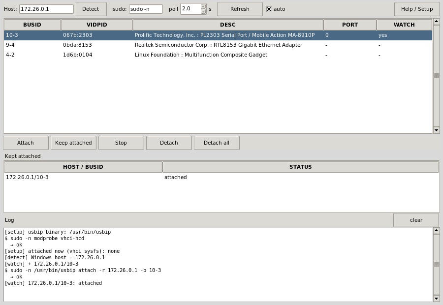
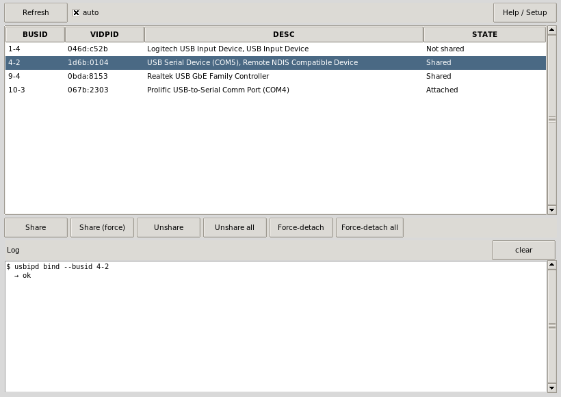

# usbip-gui

A small, single-file Tkinter front-end for **USB/IP**: share a USB device from a
Windows host with [usbipd-win](https://github.com/dorssel/usbipd-win) and attach
it inside a Linux VM (e.g. Ubuntu on Hyper-V) with `usbip`, with an
**auto re-attach** mode that keeps a device connected while the board it belongs
to reboots.

It was built for embedded development with a BeagleBone Black (USB-serial
console + USB gadget) that gets reset often, but works with any USB device.

Author: **Yassine El Harami** · License: [MIT](LICENSE)

## Screenshots

**Linux client**: a USB-serial adapter kept attached across board reboots



**Windows host**: sharing devices with usbipd-win



## Features

Run **one copy per machine** — the app detects the OS and shows the right controls.

| Machine | What you can do |
|---|---|
| **Windows host** (usbipd-win) | List devices · Share / Share (force) / Unshare / Unshare all · Force-detach / Force-detach all |
| **Linux client** (usbip) | List exported devices · Attach · **Keep attached** · Stop · Detach · Detach all |

- **Keep attached**: re-attaches a device automatically as soon as the host
  exports it again (after a board reset or a cable re-plug), and stays quiet
  while nothing is wrong.
- **Host auto-detection**: in a Hyper-V "Default Switch" VM the Windows host is
  the default gateway; the app finds it at startup (and with **Detect**).
- **Network-adapter guard**: warns before attaching anything that looks like a
  USB Ethernet adapter, since that can steal the VM's default route.
- **Transparent log**: every command the app runs is printed with its result.
- **Help / Setup** window with the install and troubleshooting notes built in.

## Requirements

- Python 3.7+ with Tkinter (included with the python.org Windows installer;
  on Ubuntu: `sudo apt install python3-tk`). No third-party packages.
- **Windows host**: usbipd-win
  ```
  winget install --interactive --exact dorssel.usbipd-win
  ```
- **Linux client**: the `usbip` tool and the `vhci-hcd` kernel module
  ```
  sudo apt install linux-tools-common linux-tools-$(uname -r)
  ```
- TCP port **3240** reachable from the VM to the host (usbipd-win's installer
  normally adds the firewall rule).

## Run

No build step: it is one script.

```
python3 usbip_gui.py        # Linux
python  usbip_gui.py        # Windows, from an Administrator terminal
```

### Linux: don't run it with sudo

Run the app as your normal user. For passwordless device operations with
sudo 1.9.10 or newer, open the policy with `sudo visudo -f /etc/sudoers.d/usbip`.
Replace any older rule in that file with this template.

```sudoers
YOUR_USER ALL=(root) NOPASSWD: /usr/bin/usbip port, \
    /usr/bin/usbip ^attach -r [a-zA-Z0-9._:%-]+ -b [0-9]+-[0-9]+([.][0-9]+)*$, \
    /usr/bin/usbip ^detach -p [0-9]+$, /usr/sbin/modprobe vhci-hcd
```

Replace `YOUR_USER` with your login name and use the system binary paths shown
in the app's startup log. The app reports errors from `usbip port` at startup.
On older sudo versions, use literal `attach -r HOST -b BUSID` and
`detach -p PORT` entries for the host, bus IDs, and local ports you use.
For interactive authorization on a desktop session, set the toolbar's `sudo`
field to `pkexec`.

### Optional: standalone Windows executable

```
pip install pyinstaller
pyinstaller --onefile --noconsole usbip_gui.py
```

The result is `dist\usbip_gui.exe`; run it as Administrator.

## Typical workflow

1. **Windows**: select the device → **Share**. Sharing (`usbipd bind`) is
   persistent, so it survives the device re-enumerating.
2. **Linux**: check the Host field (auto-detected) → select the device →
   **Keep attached** (or **Attach** for a one-off).
3. Reboot the board as often as you like; the Linux side re-attaches it within
   a poll or two.

## How "Keep attached" works

The watcher polls every 2 seconds by default.

1. It reads `usbip port` to match each local vhci port to its exporting host and
   remote busid. When only the local port is known, the app lists it separately
   and pauses auto-attach for devices that could match it.
2. It leaves existing attachments alone and waits while the host isn't
   exporting the watched device.
3. It runs `usbip attach` when the host exports the expected device model at that
   busid and the device is missing. On failure it backs off and logs the reason.

> **Local vs remote busid.** `usbip port` shows `1-1 -> usbip://<host>:3240/10-3`.
> The left id is the *local* vhci id (and is what sysfs calls `local_busid`);
> the right one is the remote busid you attach by. Comparing the two leads to
> needless re-attaches and `Device busy (exported)` errors, which this app avoids.

## Troubleshooting

**`Device busy (exported)`** — usbipd-win still thinks a (possibly dead) client
holds the device. On Windows press **Force-detach** (or run
`usbipd detach --busid <BUSID>` / `usbipd detach --all`), or unplug and replug it.

**Row marked "(attached, not exported)"** — imported locally while the host no
longer offers it. Select it and press **Detach** (or **Detach all**).

**SSH / X session drops after attaching a USB network adapter** —
NetworkManager made the new interface the default route. Use
**Help / Setup → Shield routing from USB gadgets**, which writes
`/etc/NetworkManager/conf.d/99-usbip-gui-gadgets.conf` so USB-Ethernet
interfaces stay unmanaged (**Undo shield** removes it).

**`usbip list` times out** — verify that the Windows `usbipd` firewall rule is
enabled and that its remote addresses include your VM. Shared devices are
available to clients that can reach TCP 3240, so scope the rule to the VM's IP
or the trusted VM subnet. Run this command in Administrator PowerShell.

```powershell
$vmAddress = Read-Host 'Enter the Linux VM IP address or trusted VM subnet (CIDR)'
Set-NetFirewallRule -DisplayName 'usbipd' -RemoteAddress $vmAddress -Enabled True
```

If the rule is missing, repair the usbipd-win installation and apply the scope
to the restored rule.

## What the app touches

It only runs `usbipd`, `usbip`, `modprobe` and `ip route`. It does not change the
firewall, registry, services or system files, except through three opt-in
buttons in the Help window, each of which says what it writes:
*Load vhci-hcd at boot*, *Shield routing* and *Undo shield*. These run `sh`
through sudo; if your sudoers rule only allows `usbip`/`modprobe`, run the
equivalent commands from the Help text yourself.

## License

Released under the [MIT License](LICENSE). Copyright (c) 2026 Yassine El Harami.
